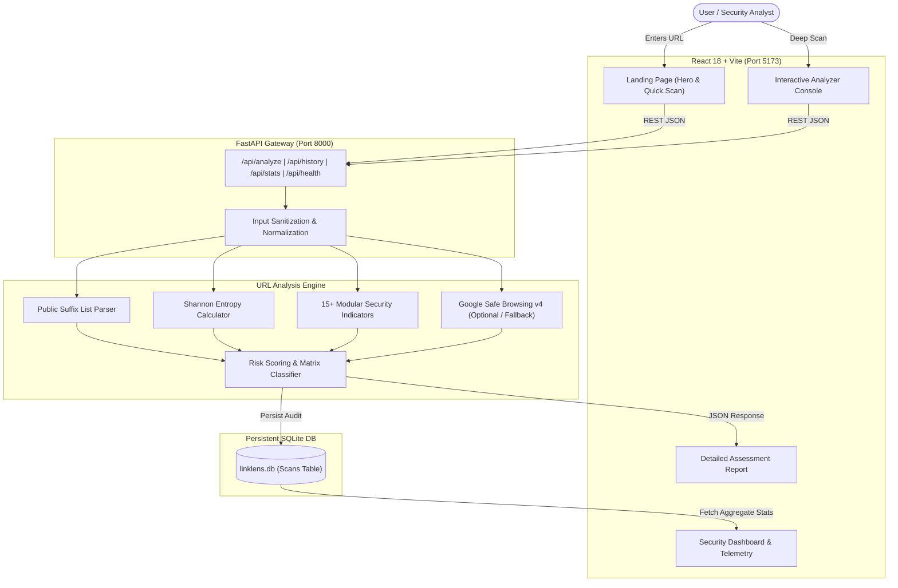

# LinkLens: AI-Powered Phishing & Malicious URL Detection System

[](https://opensource.org/licenses/MIT)
[](https://python.org)
[](https://fastapi.tiangolo.com)
[](https://react.dev)
[](https://vitejs.dev)
[](https://tailwindcss.com)

**LinkLens** is a defensive cybersecurity web application engineered to profile, diagnose, and classify suspect URLs, phishing lures, and deceptive web destinations. Built for a **B.Tech Computer Science Engineering Mini-Project Demonstration**, it combines multi-factor heuristic signal extraction, entropy evaluation, Public Suffix List (PSL) domain dissection, and threat intelligence feeds into an explainable, transparent 0–100 risk scoring engine.

---

## 1. Problem Statement & Objectives

### The Problem
Adversaries exploit deceptive URL structures to evade conventional perimeter filters and lure victims into credential theft or malware execution. Common deception tactics include:
- **Lookalike Typosquatting:** Imitating high-profile brands (e.g., `paypal-security-update.com` or `paypa1.com`).
- **Punycode / IDN Homoglyphs:** Using foreign alphabet characters (such as Cyrillic `а`) that render identically to Latin characters in browser address bars.
- **Subdomain Stacking:** Prepending brand names into deep subdomain chains to fool mobile screen viewports.
- **URL Shortener Masking:** Hiding destination infrastructure behind link redirect services.
- **Padlock Fallacy:** Over 80% of modern phishing pages now use valid HTTPS/TLS certificates, nullifying the traditional "look for the padlock" rule.

### Core Objectives
1. **Zero-Fetch Architecture:** Inspect URLs structurally and algorithmically without connecting to or visiting the target host, completely mitigating Server-Side Request Forgery (SSRF) and malicious script execution.
2. **Transparent Heuristic Scoring:** Provide a deterministic 0–100 risk score with documented point weights rather than an unexplainable "black box."
3. **Multi-Vector Diagnostic Breakdown:** Assess 15+ independent security indicators categorized by URL Structure, Domain Characteristics, Pattern Anomalies, and Reputation.
4. **Persistent Threat Telemetry:** Store authentic historical scan logs in a local SQLite database and display genuine aggregate statistics on an interactive dashboard.
5. **Actionable Defense:** Give users concrete remediation steps and explain why a destination is dangerous.

---

## 2. Architecture & System Flow



---

## 3. Heuristic Scoring Convention & Matrix

LinkLens computes risk scores on a **0 to 100 scale**, where higher scores indicate greater observed threat risk:

| Score Range | Classification | Indicator Profiles & Evidence |
| :--- | :--- | :--- |
| **0 – 24** | **Low Observed Risk** | Clean standard hostname, standard HTTPS, normal length, no deceptive brand patterns. *(Disclaimer: Absence of detected anomalies does not prove 100% safety).* |
| **25 – 49** | **Moderate Observed Risk** | Minor anomalies observed: unencrypted HTTP scheme, known link shortener, multiple redirect parameters, or non-standard port. |
| **50 – 74** | **High Observed Risk** | Significant suspicious indicators: Raw IP address in hostname, excessive subdomain stacking (≥3 levels), high credential keyword lures, or high Shannon entropy. |
| **75 – 100** | **Critical Observed Risk** | Severe threats: Brand name typosquatting / deception, IDN Punycode homoglyphs, direct executable payloads (`.exe`, `.scr`), or verified matches in threat intelligence. |

---

## 4. Technology Stack

- **Frontend:**
  - React 18 with Vite
  - Tailwind CSS (Custom Dark Navy & Cyber Cyan palette)
  - Lucide React (Cybersecurity & system icons)
  - Recharts (Risk distribution bar & pie telemetry charts)
  - React Router DOM v6
- **Backend:**
  - Python 3.9+
  - FastAPI (High-performance async ASGI web framework)
  - Pydantic v2 (Strict schema validation)
  - Uvicorn (ASGI web server)
  - tldextract (Robust registrable domain extraction via Public Suffix List)
  - SQLAlchemy 2.0 (ORM database engine)
  - HTTPX (Async HTTP client for threat intelligence)
  - Pytest & FastAPI TestClient (Automated test suite)
- **Database:**
  - SQLite (`linklens.db`) with automatic table migration on startup

---

## 5. Prerequisites & Environment Setup

### Prerequisites
- **macOS** (Apple Silicon M1/M2/M3/M4 or Intel) or Linux
- **Node.js** v18+ and **npm**
- **Python** 3.9+

### Project Structure
```text
Link-lens-/
├── backend/
│   ├── app/
│   │   ├── api/routes.py          # REST API endpoints
│   │   ├── config.py              # Environment configuration
│   │   ├── database/session.py    # SQLAlchemy engine and SQLite session
│   │   ├── models/scan.py         # Database model definitions
│   │   ├── schemas/scan.py        # Pydantic request/response schemas
│   │   ├── services/
│   │   │   ├── analyzer.py        # Master analysis coordinator
│   │   │   ├── heuristics.py      # 15+ cybersecurity heuristic checks
│   │   │   ├── recommendations.py # Safety guidance generator
│   │   │   ├── scoring.py         # Transparent risk scoring engine
│   │   │   ├── threat_intel.py    # Google Safe Browsing integration
│   │   │   └── url_parser.py      # Safe parsing & entropy calculator
│   │   └── main.py                # FastAPI ASGI application entrypoint
│   ├── tests/
│   │   ├── test_analyzer.py       # Heuristics and scoring unit tests
│   │   └── test_api.py            # API integration & SSRF defense tests
│   ├── requirements.txt           # Python dependencies
│   ├── .env                       # Backend local configuration
│   └── .env.example
├── frontend/
│   ├── src/
│   │   ├── components/            # Navbar, Footer, RiskGauge, IndicatorCard, etc.
│   │   ├── pages/                 # LandingPage, Dashboard, Analyzer, Results, About
│   │   ├── services/api.js        # Centralized fetch API client
│   │   ├── utils/formatters.js    # Data formatting and export helpers
│   │   ├── App.jsx                # Router definition
│   │   └── main.jsx
│   ├── package.json
│   ├── tailwind.config.js
│   ├── vite.config.js
│   └── .env.example
├── .gitignore
└── README.md
```

---

## 6. Installation & Execution Instructions

### Step 1: Set Up Backend (Python Virtual Environment)

1. Open a terminal in the project root:
   ```bash
   cd backend
   ```
2. Create and activate a Python virtual environment:
   ```bash
   python3 -m venv venv
   source venv/bin/activate
   ```
3. Install backend dependencies:
   ```bash
   pip install --upgrade pip
   pip install -r requirements.txt
   ```
4. Verify environment configuration:
   ```bash
   cp .env.example .env
   ```
   *(Optional: Add your `GOOGLE_SAFE_BROWSING_API_KEY` in `.env` if desired; the application gracefully defaults to offline heuristic mode if empty).*

5. Start the FastAPI backend server:
   ```bash
   python -m uvicorn app.main:app --host 127.0.0.1 --port 8000 --reload
   ```
   The backend API will be live at `http://127.0.0.1:8000`.
   Interactive Swagger docs are available at `http://127.0.0.1:8000/docs`.

---

### Step 2: Set Up Frontend (React + Vite)

1. Open a second terminal window in the project root:
   ```bash
   cd frontend
   ```
2. Install npm dependencies:
   ```bash
   npm install
   ```
3. Launch the Vite development server:
   ```bash
   npm run dev
   ```
4. Open your browser and navigate to:
   ```text
   http://localhost:5173
   ```

---

## 7. Running Automated Tests

LinkLens includes an automated backend test suite covering input validation, dangerous scheme rejection, IP address parsing, brand impersonation, punycode detection, scoring boundaries, database CRUD, and SSRF prevention.

Execute all tests from the root directory:
```bash
PYTHONPATH=. backend/venv/bin/pytest backend/tests/ -v
```

Expected output:
```text
============================= test session starts ==============================
backend/tests/test_analyzer.py::test_valid_https_url PASSED               [  5%]
backend/tests/test_analyzer.py::test_missing_scheme_defaults_to_https PASSED [ 10%]
backend/tests/test_analyzer.py::test_valid_http_url PASSED                [ 15%]
backend/tests/test_analyzer.py::test_unsupported_schemes_rejected PASSED  [ 20%]
backend/tests/test_analyzer.py::test_malformed_urls_rejected PASSED       [ 25%]
backend/tests/test_analyzer.py::test_ip_address_detection PASSED          [ 30%]
backend/tests/test_analyzer.py::test_brand_impersonation_detection PASSED [ 35%]
backend/tests/test_analyzer.py::test_punycode_homoglyph_detection PASSED [ 40%]
backend/tests/test_analyzer.py::test_long_url_detection PASSED           [ 45%]
backend/tests/test_analyzer.py::test_shortener_detection PASSED          [ 50%]
backend/tests/test_analyzer.py::test_userinfo_at_symbol_detection PASSED  [ 55%]
backend/tests/test_analyzer.py::test_risk_score_bounds_and_levels PASSED  [ 60%]
backend/tests/test_analyzer.py::test_recommendations_generation PASSED    [ 65%]
backend/tests/test_api.py::test_health_endpoint PASSED                    [ 70%]
backend/tests/test_api.py::test_analyze_valid_url PASSED                  [ 75%]
backend/tests/test_api.py::test_analyze_suspicious_url PASSED            [ 80%]
backend/tests/test_api.py::test_analyze_invalid_url_scheme PASSED         [ 85%]
backend/tests/test_api.py::test_analyze_malformed_empty PASSED            [ 90%]
backend/tests/test_api.py::test_stats_and_history_lifecycle PASSED        [ 95%]
backend/tests/test_api.py::test_no_arbitrary_outbound_fetches_to_target PASSED [100%]
============================== 20 passed in 0.54s ==============================
```

---

## 8. API Specification & Examples

### `GET /api/health`
Returns health check and threat intelligence configuration status.
```json
{
  "status": "healthy",
  "service": "LinkLens API",
  "version": "1.0.0",
  "threat_intel_configured": false,
  "timestamp": "2026-10-30T01:00:00Z"
}
```

### `POST /api/analyze`
**Request:**
```json
{
  "url": "http://paypal-security-update-account.com/verify"
}
```

**Response:**
```json
{
  "scan_id": "9b1deb4d-3b7d-4bad-9bdd-2b0d7b3dcb6d",
  "submitted_url": "http://paypal-security-update-account.com/verify",
  "normalized_url": "http://paypal-security-update-account.com/verify",
  "hostname": "paypal-security-update-account.com",
  "domain": "paypal-security-update-account.com",
  "risk_score": 68,
  "risk_level": "high",
  "summary": "High risk profile (68/100): Suspicious patterns detected including Brand Name Incongruity / Typosquatting. Significant deceptive characteristics suggest caution is warranted.",
  "indicators": [
    {
      "id": "brand_impersonation",
      "name": "Brand Name Incongruity / Typosquatting",
      "category": "domain",
      "severity": "critical",
      "status": "detected",
      "weight": 40,
      "explanation": "The URL references brand name(s) [paypal] inside subdomains or an unofficial root domain ('paypal-security-update-account.com')...",
      "recommended_action": "Do not log in or provide payment details. Navigate to the verified official portal independently."
    }
  ],
  "url_details": {
    "submitted_url": "http://paypal-security-update-account.com/verify",
    "normalized_url": "http://paypal-security-update-account.com/verify",
    "scheme": "http",
    "hostname": "paypal-security-update-account.com",
    "domain": "paypal-security-update-account.com",
    "tld": "com",
    "url_length": 49,
    "has_ip": false,
    "entropy": 3.78
  },
  "recommendations": [
    "Brand Deception Alert: Do NOT enter credentials or payment info...",
    "Unencrypted connection (HTTP): Never transmit personal data over unencrypted channels."
  ],
  "threat_intelligence": {
    "checked": false,
    "status": "not_configured",
    "provider": "Google Safe Browsing v4",
    "details": "External threat intelligence key not configured. Security assessment is grounded solely in local heuristic and structural signal analysis.",
    "matches": []
  },
  "analyzed_at": "2026-10-30T01:00:00Z"
}
```

---

## 9. Threat Intelligence Integration (Google Safe Browsing v4)

1. Obtain a Google Safe Browsing API v4 key from the [Google Cloud Console](https://console.cloud.google.com/).
2. Enable the **Safe Browsing API**.
3. In `backend/.env`, set:
   ```env
   GOOGLE_SAFE_BROWSING_API_KEY=your_actual_api_key_here
   ```
4. Restart the FastAPI backend.
5. If the key is left empty or invalid, LinkLens smoothly operates in **Heuristic-Only Mode** and explicitly informs the user that external reputation lookups were skipped.

---

## 10. Security Safeguards

- **SSRF Defense:** Under no circumstances does the backend make HTTP requests or establish TCP connections to the submitted URL.
- **Input Validation:** Restricts schemes strictly to `http` and `https`, rejects dangerous protocols (`javascript:`, `data:`, `file:`, `blob:`), and bounds inputs to 2048 characters.
- **Data Protection:** Database records never store secrets or API credentials.
- **Safe Text Rendering:** React's virtual DOM escapes all rendered strings, preventing DOM-based Cross-Site Scripting (XSS).

---

## 11. Known Limitations & Future Enhancements

### Current Limitations
- **Dynamic Content Obfuscation:** Attackers serving geo-fenced content or CAPTCHAs to automated tools cannot be fingerprinted without active rendering.
- **Newly Registered Domains (NRDs):** Brand-new malicious domains not yet categorized on public threat registries require passive DNS telemetry for earlier detection.

### Future Improvements
- Integration with WHOIS / RDAP lookup for domain age estimation.
- Passive DNS telemetry and certificate transparency log auditing.
- Machine Learning classification model trained on PhishTank and URLhaus corpora to complement heuristic weights.
